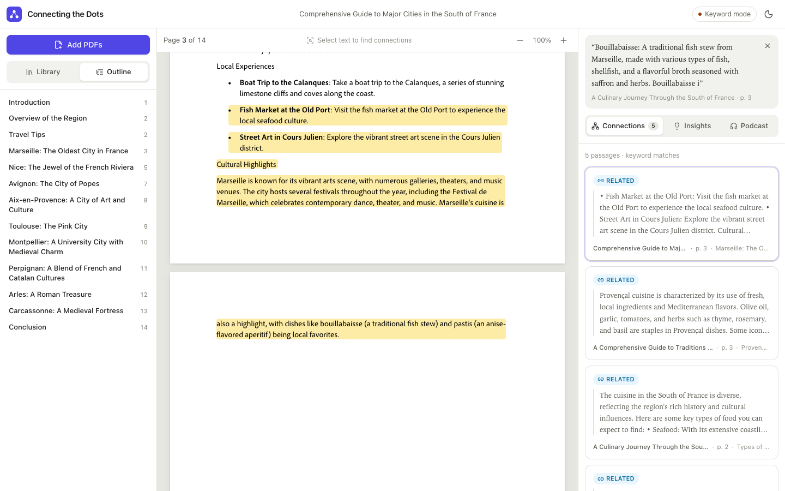
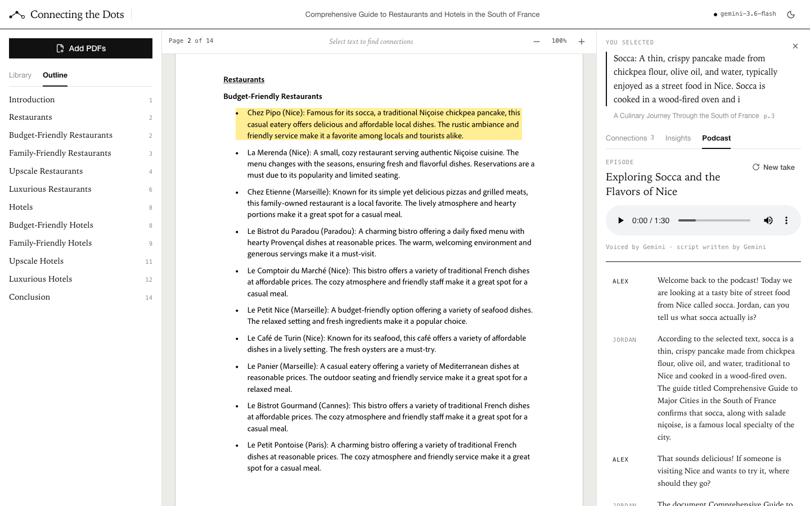
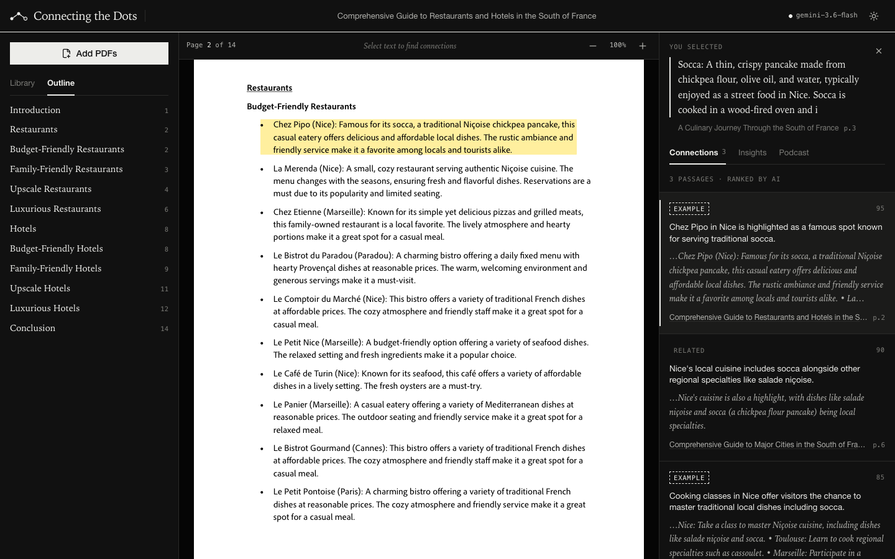
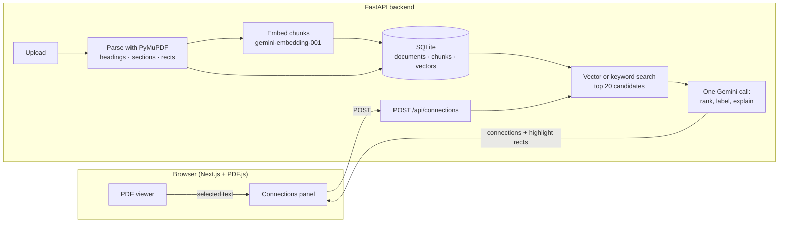

# Connecting the Dots

Read your PDFs and see how the ideas in them connect. Select a passage in any
document, and the app finds where the rest of your library **supports**,
**contradicts**, **gives an example of**, or **relates to** it. One click jumps
to the exact passage in the source document, highlighted. You can also generate
insights on a passage or listen to a short two-host podcast about it.



Originally built for the *Connecting the Dots* challenge of the Adobe India
Hackathon 2025, then rebuilt (v2) to be reliable, simpler to run and easier to
maintain. See [What changed in v2](#what-changed-in-v2).

---

## Contents

- [Features](#features)
- [Quick start](#quick-start)
- [Configuration](#configuration)
- [How it works](#how-it-works)
- [API](#api)
- [Project structure](#project-structure)
- [Development and testing](#development-and-testing)
- [Troubleshooting](#troubleshooting)
- [What changed in v2](#what-changed-in-v2)

## Features

| | |
|---|---|
| **Library** | Upload up to 30 PDFs at once (or drag them anywhere onto the page). Documents are indexed in the background. Duplicates are detected by content. Failed documents can be retried. |
| **Reader** | PDF.js viewer with real text selection, zoom, and an outline of detected sections. |
| **Connections** | Select text → *Find connections*. Each result says how it relates and why, and clicking it opens the source page with the passage highlighted. |
| **Insights** | Summary, key takeaways, contradictions, examples and "did you know" facts, grounded only in your documents. |
| **Podcast** | A short two-host episode about the passage. It's voiced by Gemini when available, and otherwise read aloud by the browser. |
| **Works without AI** | With no API key the app still runs: keyword-based connections, a scripted podcast and browser voices. |
| **Polish** | Light/dark theme, responsive layout (drawers on small screens), keyboard-accessible tabs, clear loading, empty and error states. |

<table>
  <tr>
    <td></td>
    <td></td>
  </tr>
</table>

## Quick start

### Option A: Docker (one command)

```bash
docker compose up --build
```

Open <http://localhost:8080>. To enable the AI features, create a `.env` file
next to `docker-compose.yml` containing `GEMINI_API_KEY=your-key` (get one at
[Google AI Studio](https://aistudio.google.com/apikey)) and run the command
again. Data is kept in the `ctd-data` Docker volume.

Without Compose:

```bash
docker build -t connecting-the-dots .
docker run -p 8080:8080 -v ctd-data:/data -e GEMINI_API_KEY=your-key connecting-the-dots
```

### Option B: Local development

Requirements: **Python 3.12+** (tested on 3.14) and **Node.js 22.13+**.

```bash
# 1. Backend (http://127.0.0.1:8000, API docs at /docs)
cd backend
python3 -m venv .venv
.venv/bin/pip install -r requirements-dev.txt
cp .env.example .env            # optional: add GEMINI_API_KEY
.venv/bin/python -m app

# 2. Frontend (http://localhost:3000), in a second terminal
cd frontend_app
npm install
npm run dev
```

## Configuration

All settings are environment variables (or `backend/.env`). All of them are optional.

| Variable | Default | Purpose |
|---|---|---|
| `GEMINI_API_KEY` | *(empty)* | Enables semantic search, AI ranking, insights and the AI-written podcast. `GOOGLE_API_KEY` is accepted too. |
| `GEMINI_MODEL` | `gemini-2.5-flash` | Model for ranking, insights and podcast scripts. |
| `EMBEDDING_MODEL` | `gemini-embedding-001` | Embedding model. Changing it re-indexes documents on the next start. |
| `TTS_ENABLED` | `true` | Set `false` to always use browser speech. |
| `TTS_API_KEY` | *(uses `GEMINI_API_KEY`)* | Separate key for Gemini text-to-speech. |
| `TTS_MODEL` | `gemini-2.5-flash-preview-tts` | Multi-speaker TTS model. |
| `DATA_DIR` | `backend/data` (`/data` in Docker) | SQLite database, uploaded PDFs, generated audio. |
| `HOST` / `PORT` | `127.0.0.1` / `8000` (`0.0.0.0` / `8080` in Docker) | Server address. |
| `CORS_ORIGINS` | `http://localhost:3000` | Comma-separated origins allowed to call the API. |
| `FRONTEND_DIST` | *(empty)* | Folder of the exported frontend to serve at `/` (set in Docker). |
| `NEXT_PUBLIC_API_URL` | `http://127.0.0.1:8000` in dev, empty in production | Frontend → API base URL (`frontend_app/.env.development`). |

### What works with and without a key

| | No key | With `GEMINI_API_KEY` |
|---|---|---|
| Upload, read, outline | ✅ | ✅ |
| Connections | Keyword (TF-IDF) matches | Semantic search + Gemini labels each match and explains why |
| Insights | Explains that a key is needed | ✅ |
| Podcast | Scripted walkthrough, browser voice | Gemini-written dialogue, Gemini voices (falls back to the browser if TTS fails) |

If a Gemini call fails (invalid key, quota, network), the feature falls back to
the keyword or browser path and the UI says why. Nothing crashes.

## How it works



1. **Indexing.** Each uploaded PDF is stored under its content hash. PyMuPDF
   reads the text with font information. Headings are detected from size and
   weight (or taken from the PDF's own bookmarks). The text is split into
   section-aware chunks of about 220 words, each with the rectangles of its
   text blocks as fractions of the page size. Chunks are embedded with Gemini
   when a key is available.
2. **Connections.** The selected text is matched against every chunk in the
   library: cosine similarity over embeddings, or TF-IDF without a key. The
   chunk the selection came from is excluded. The top candidates go to Gemini
   in one structured-output call, which returns a relation, a relevance score
   and a one-sentence reason for each passage worth showing.
3. **Highlights.** The frontend draws each chunk's stored rectangles over the
   rendered page. Because they are page fractions, they line up at any zoom.
4. **Insights and podcast.** These are stateless requests that carry the
   selection and the IDs of the connected chunks. The podcast script comes
   back as structured lines. When Gemini TTS is available it is voiced as a
   WAV; otherwise the browser's `speechSynthesis` reads it with two voices.

## API

Interactive documentation is served at **`/docs`** (Swagger UI) when the backend runs.

| Method & path | Purpose |
|---|---|
| `GET /api/health` | Status, whether AI is enabled, TTS mode, document count |
| `GET /api/documents` | List documents with their indexing status |
| `POST /api/documents` | Upload PDFs (`multipart/form-data`, field `files`) |
| `GET /api/documents/{id}` | Document details and outline |
| `GET /api/documents/{id}/file` | The PDF itself |
| `DELETE /api/documents/{id}` | Delete a document and its index |
| `POST /api/documents/{id}/reindex` | Process a document again |
| `POST /api/connections` | `{text, document_id?, page?}` → related passages |
| `POST /api/insights` | `{text, chunk_ids}` → structured insights (needs a key) |
| `POST /api/podcast` | `{text, chunk_ids, insights?}` → script, plus an audio URL when Gemini TTS is available |
| `GET /api/podcast/audio/{id}` | Generated podcast audio (WAV) |

## Project structure

```
.
├── backend/                 FastAPI service. See backend/README.md
│   ├── app/
│   │   ├── api/             HTTP routes
│   │   ├── services/        pdf_processing, indexer, search, analysis, ai (Gemini)
│   │   ├── config.py        settings
│   │   ├── db.py            SQLite storage
│   │   └── schemas.py       request/response models
│   └── tests/               pytest (generated PDFs, fake Gemini, no network)
├── frontend_app/            Next.js app. See frontend_app/README.md
│   ├── src/components/      workspace, library, viewer, analysis, ui
│   ├── src/hooks/ src/lib/  data hooks, API client, types, browser speech
│   └── e2e/                 Playwright end-to-end tests + fixture PDFs
├── Dockerfile               multi-stage: builds the frontend, serves everything on :8080
├── docker-compose.yml
└── .github/workflows/ci.yml lint, tests, build, e2e and Docker smoke test
```

## Development and testing

| | Command | Where |
|---|---|---|
| Backend tests | `.venv/bin/python -m pytest` | `backend/` |
| Backend lint/format | `.venv/bin/ruff check app tests && .venv/bin/ruff format --check app tests` | `backend/` |
| Frontend lint / types | `npm run lint` · `npm run typecheck` | `frontend_app/` |
| Frontend unit tests | `npm test` | `frontend_app/` |
| End-to-end tests | `npm run build && npm run test:e2e` | `frontend_app/` |

The end-to-end tests start the real backend (no API key) serving the built
frontend. They upload the fixture PDFs, select text, open a connection, check
the highlight, generate a podcast and check the mobile layout. They use
Playwright's Chromium (`npx playwright install chromium`). Set `PW_CHANNEL=chrome`
to use an installed Chrome instead, and `E2E_PYTHON` if the backend's Python
isn't at `backend/.venv/bin/python`.

CI runs all of the above on every push to `main` and on every pull request,
and smoke-tests the Docker image.

Two rules for contributors:
- **Keep `frontend_app/src/lib/types.ts` in sync with `backend/app/schemas.py`.**
- **Only `backend/app/services/ai.py` imports the Gemini SDK**, so the rest of
  the backend stays testable without network access.

## Troubleshooting

| Symptom | Fix |
|---|---|
| Header shows **Offline** | The backend isn't running or isn't at `NEXT_PUBLIC_API_URL`. Start it with `python -m app` in `backend/`. |
| Header shows **Keyword mode** although you set a key | Restart the backend after editing `.env`. Check that the variable is `GEMINI_API_KEY`. |
| Documents show *Semantic indexing failed, keyword search only* | The key is invalid or out of quota. Fix the key and restart: keyword-only documents are re-indexed automatically. |
| *PDF contains no extractable text* | The PDF is a scanned image. Run it through OCR first (e.g. `ocrmypdf`). |
| Podcast plays with a robotic voice | That's the browser fallback. Gemini TTS is unavailable; the tab says why. |
| `npm install` / `npm run dev` fails on PDF.js | Use Node.js 22.13 or newer. |
| Port already in use | Set `PORT=...` for the backend, or change the left side of `8080:8080` in `docker-compose.yml`. |

## What changed in v2

The hackathon version had stopped working. Its Gemini models were retired and
its SDK deprecated, `python main.py` never started a server, and the Adobe
viewer's cross-origin iframe made the screenshot-based pipeline send blank
images. v2 is a rebuild:

- **Backend:** SQLite replaces MongoDB and ChromaDB. The current `google-genai`
  SDK replaces the deprecated one. There is one structured ranking call per
  search instead of up to 100 sequential LLM calls. Endpoints are stateless (no
  shared result files), uploads are deduplicated and sanitised, and dependencies
  are pinned. There's a full pytest suite.
- **Frontend:** PDF.js replaces Adobe PDF Embed, with real text selection and
  highlights. Connections open the correct document. The podcast actually plays.
  The three-panel UI has light and dark themes and works on mobile.
- **Operations:** a working multi-stage Docker image on one port, Compose, and
  CI with unit, end-to-end and container tests.
- **Security:** an API key that had been committed was removed (it is no
  longer valid, but it remains in git history) and `.env` files are git-ignored.

## License

No license has been chosen yet. Add a `LICENSE` file before publishing or
accepting outside contributions.
